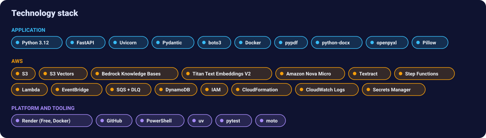

<div align="center">





</div>

## Handbook

Everything you need to run, change, move and clean up CleanDocs AI. Open the guide you need:

| # | Guide | Use it when |
|---|---|---|
| a | [Operator handbook](docs/operator-handbook.md) | You want to **upload** a file or ZIP, **track** it, **reconcile**, read the results, fix a problem, or deal with **Render sleep** |
| b | [Delete assets from the AWS account](docs/aws-teardown.md) | You are leaving this AWS account (or stopping the project) and want **zero charges**: inventory of every resource and the one-command teardown |
| c | [Set up in a new AWS account](docs/new-account-setup.md) | You want a **fresh infrastructure** in a new account: values you need, where to find them, step by step |
| d | [Delete documents](docs/delete-documents.md) | You want to **delete one file, several files, a whole upload or everything** (and re-ingest) |
| e | [Deploy to Render and push to Git](docs/render-and-git-deploy.md) | You changed code or settings and need to **push and deploy** the right part |

Full index with reference documents: [`docs/README.md`](docs/README.md). Coming back after a break? Read [`docs/PROJECT-STATE.md`](docs/PROJECT-STATE.md) first.

---

## 1. What it is, the problem, and how it is solved

**The problem.** Personal and business documents arrive in every shape: digital PDFs, phone scans, Word and Excel files, ZIP bundles of all of them.
To search them with AI you must turn them into clean, trustworthy text, remember where every sentence came from, know who may see it, avoid
indexing the same file twice, and be able to prove afterwards that everything really got indexed. Doing that with one big script is fragile:
one bad file stops the batch, nothing tells you what happened, and every change risks the whole thing.

**The solution: CleanDocs AI** takes any supported file (or a ZIP of files), runs it through a pipeline of small, single-purpose services, and
publishes **citation-ready chunks with rich metadata** into an Amazon Bedrock Knowledge Base. Ingestion and indexing only; the chat/search API
(`query-api`) comes next and is designed for.

| Principle | What it means here |
|---|---|
| **Microservices** | 16 small FastAPI services, one job each (validate, unzip, OCR, enrich, chunk, index, reconcile...). Each has its own Dockerfile, health checks and tests. A bug or change in one stage never touches the others. |
| **Easy to deploy** | One generated `render.yaml` Blueprint creates all services; AWS is two CloudFormation stacks; helper scripts do the rest (`deploy-infra`, `deploy-orchestration`, `deploy-render`, `warm-up`). A new AWS account is rebuilt by following one guide. |
| **Metadata driven** | Every chunk carries `owner`, `doc_type`, `tags`, `doc_date`, `language`, `file_kind`, `page`/`section`, OCR confidence, PII flag. Behaviour (limits, caps, models, chunk sizes) comes from configuration, not code edits. |
| **Scalable** | Stateless services; storage in S3, DynamoDB and S3 Vectors (serverless, grow with data); Step Functions coordinates; concurrency is one setting (`MAX_CONCURRENT_FILES`, default 1 for the free-tier home-lab, raise it with a bigger Render plan); each stage can be scaled or replaced alone. |
| **Highly resilient** | Idempotent stages (same input + same version = skipped, not redone), retries with back-off, readiness checks that outlast sleeping Render instances, a dead-letter queue and a replay tool, "soft" stages (LLM, entities, graph) that can never fail a document, and an evidence-based **reconciliation** that re-checks S3 and the Knowledge Base instead of trusting status flags. |
| **Auditable** | Every service call writes an append-only STARTED/COMPLETED row to DynamoDB; every document has stored artifacts for each stage. |
| **Low cost** | Free-tier compute, serverless storage, hard monthly caps on OCR pages and LLM calls, a very small LLM (Amazon Nova Micro). |

---

## 2. Security: what is protected and what protects it

| Risk | Protection in the system |
|---|---|
| Anyone calling a service | Every endpoint except `/health/*` requires `Authorization: Bearer <secret>`; compared in constant time; **fails closed** (503) if no secret is configured. Swagger/OpenAPI pages are disabled. |
| Secret leaking into workflows | Step Functions calls services through an EventBridge **Connection**; the secret is held in AWS Secrets Manager, not in the workflow definition. Secrets are never committed (`.gitignore`, repo scan before push). |
| A stolen key doing too much | **Three least-privilege IAM tiers** (`ingest`, `processing`, `indexing`); each Render service gets only one tier's key. Render never holds admin credentials. Keys can be rotated independently. |
| Tampering with originals | S3 bucket is private, encrypted (SSE-S3), versioned, TLS-only; originals are written once (`If-None-Match`), checksum-verified by S3, and **only the admin principal may delete under `raw/`**. |
| Wrong or hostile files | Type is detected from file content (magic bytes), not the extension; size, page and image-pixel limits; filenames sanitised. |
| ZIP bombs / path tricks | Limits on expanded size, file count, nesting depth and compression ratio; entry paths sanitised; children validated individually. |
| Prompt injection through documents | The LLM is told the text is data, not instructions; its answer must be strict JSON and is validated against a closed vocabulary and patterns before anything is stored; it can only add labels. |
| Personal data | LLM flags PII (`has_pii`, types); chunk metadata carries `owner` so the query layer can filter per user (`ADMIN` sees all). The bucket and Knowledge Base are private to your account. |
| Duplicate or replayed uploads | `Idempotency-Key` replays return the stored answer; exact duplicates are detected by SHA-256. |
| Runaway cost (abuse or mistakes) | Monthly caps on Textract pages and LLM documents; one-file-at-a-time gate. |
| "Did it really happen?" | Append-only audit trail + reconciliation that re-checks evidence (original exists and hash matches, every chunk object present, Knowledge Base lists it as INDEXED, sidecar owner matches registry). |
| Safe cleanup | Delete tools are dry-run first, refuse while workflows run, and delete-all needs a typed confirmation. |

---

## 3. Why this is good at query time

The index is built for the **query-api** you will add next, so retrieval can be semantic *and* filtered:

- **Owner-aware answers.** `owner` is in every chunk. The query layer applies `owner == user` (or no filter for `ADMIN`).
- **Metadata filters before/with vector search.** Filter by `doc_type` (identity_document, bank_document, tax_document, invoice, contract...), `tags`, `doc_date`, `uploaded_at` (numeric for ranges), `language`, `file_kind`, `has_pii`, `ingestion_id`.
- **Real citations.** Each chunk keeps `document_id`, `filename`, ZIP entry path, `page_start`/`page_end`, `sheet`, `section`; the answer can say exactly where a fact came from.
- **Clean, right-sized chunks.** Layout-aware splitting (headings, tables with repeated header rows, sentence-aware paragraphs with overlap), one chunk per object so a hit maps to one citation.
- **Quality signals.** `ocr_confidence` and `ocr_low_confidence` let the chatbot warn "scanned text, may contain errors".
- **Stable identity.** Chunk ids come from the text hash, so re-ingesting identical content does not create duplicates.
- **Fast "my documents" lists.** Registry index by owner is planned (phase 10C).
- Contract: [`docs/citations.md`](docs/citations.md).

---

## 4. AWS services used, and why

| Service | Why it was chosen |
|---|---|
| **S3** | Durable, cheap, versioned storage for originals, every stage output and the chunk files Bedrock reads |
| **S3 Vectors** | Serverless vector store with no idle cluster cost (versus OpenSearch) |
| **Bedrock Knowledge Bases** | Managed embedding + indexing + retrieval API; we only supply chunk files and metadata |
| **Titan Text Embeddings V2** | Inexpensive multilingual embeddings (1024-dim) used by the Knowledge Base |
| **Amazon Nova Micro** | Very small, low-cost LLM for document labels (type, tags, summary, PII) |
| **Textract** | OCR for scanned PDFs and photos, with confidence scores |
| **Step Functions** | Visible, retryable orchestration of two workflows (ingestion, per-file) with waits, loops and error routing |
| **Lambda + EventBridge** | Small dispatcher on a 5-minute schedule that feeds files through the single-file gate; EventBridge Connection injects the auth header |
| **SQS + DLQ** | Queue of files to process and a dead-letter queue that keeps failures for replay |
| **DynamoDB** | Pay-per-request registry (documents, ingestions, claims, counters) and the append-only audit trail |
| **IAM** | Three least-privilege tiers plus admin-only deletes of originals |
| **Secrets Manager** | Holds the service secret behind the EventBridge Connection |
| **CloudFormation** | The whole AWS side is two templates: repeatable in any account |
| **CloudWatch Logs** | Workflow and dispatcher logs |
| **Render (outside AWS)** | Free Docker hosting for the 16 services; AWS is reached with the least-privilege keys |

---

## 5. The services, in pipeline order

| # | Service | What it does | Benefit |
|---|---|---|---|
| 1 | **upload** | Receives file + optional `owner`, hashes it, stores the untouched original, registers it, starts the workflow | Immutable originals, idempotent retries, owner from the first byte |
| 2 | **validation** | Detects the true file type, size, page limits | Bad files are rejected early and safely |
| 3 | **archive** | Safely unzips; each entry becomes its own document (inherits owner) | ZIP of 50 files = 50 tracked documents; ZIP-bomb protection |
| 4 | **manifest** | Lists the files of an ingestion and rolls up status | One call tells you where an upload stands |
| 5 | **normalization** | Converts PDF/Word/Excel/CSV/text/images to page/block JSON; flags pages that need OCR | One uniform format for everything after it |
| 6 | **cleaning** | Fixes whitespace, hyphenation, control characters | Better embeddings and answers |
| 7 | **duplicate** | Exact-duplicate detection by SHA-256 (skip, link or reprocess) | No double indexing, no double cost |
| 8 | **extraction** | Keeps real text; OCRs scanned pages (a few per call, monthly cap); stores confidence | Scans become searchable, spend is bounded |
| 9 | **metadata** | Rule-based title, type guess, language hint, dates, keywords | Free first-pass labels |
| 10 | **enrichment** | One Nova Micro call: doc type, tags, description, title, language, date, PII flag (soft stage) | Metadata-driven search; never blocks a document |
| 11 | **chunking** | Layout-aware chunks with locators for citations | Right-sized, citable passages |
| 12 | **embedding** | Validates chunks, writes chunk + metadata sidecar for Bedrock | A document becomes visible only when complete |
| 13 | **vector-indexing** | Starts and polls the Bedrock ingestion job | Embedding and vector storage handled by AWS |
| 14 | **reconciliation** | Re-checks S3 and the Knowledge Base; sets the final status with evidence | You can trust "COMPLETED" |
| 15 | **entity-extraction** | Optional entity candidates (people, orgs, money, ids) | Foundation for a knowledge graph; never blocks |
| 16 | **graph** | Skeleton for a future knowledge graph | Reserved extension point |

Flow: `upload` -> workflow `cleandocs-ingestion` (`validation` -> `archive` for ZIPs -> `manifest`) -> per file, one at a time in workflow `cleandocs-file`
(`validation` -> `normalization` -> `cleaning` -> `duplicate` -> `extraction` -> `metadata` -> `enrichment` -> `chunking` -> `embedding`, then optional
`entity-extraction`, `graph`) -> `vector-indexing` -> `reconciliation`.

---

## 6. Project structure

```text
docindex/
├── README.md                    this page
├── render.yaml                  Render Blueprint for all 16 services (generated by scripts/build_render_yaml.py)
├── requirements-local.txt       packages for local runs and tests
├── shared/cleandocs_shared/     common library: config, auth, registry, audit trail, pipeline, chunk/metadata helpers
├── services/                    one folder per microservice: <name>-service/{Dockerfile, <name>_service/, tests}
│   ├── upload-service/  validation-service/  archive-service/  manifest-service/
│   ├── normalization-service/  cleaning-service/  duplicate-service/  extraction-service/
│   ├── metadata-service/  enrichment-service/  chunking-service/  embedding-service/
│   └── vector-indexing-service/  reconciliation-service/  entity-extraction-service/  graph-service/
├── workflows/                   Step Functions definitions (asl.py, build.py, validate.py)
├── workers/sqs-dispatcher/      dispatcher Lambda that feeds files through the gate
├── infrastructure/              CloudFormation: cleandocs-core.yaml, cleandocs-orchestration.yaml
├── scripts/                     deploy-*.ps1, warm-up.ps1, cleandocs.ps1 (list/delete), teardown-account.ps1, local_gateway.py, smoke_test_pipeline.py ...
├── tests/                       unit + integration tests (mocked AWS, ~175)
└── docs/                        handbook (README.md index), project state, guides, design notes, assets/
```

---

## 7. Architecture diagram

> _Placeholder: the architecture diagram will be added here._
>
> `
`

---

## Status

| Phase | Scope | State |
|---|---|---|
| 0-1 | Architecture, shared foundation | Done |
| 2 | AWS core infrastructure | Deployed |
| 3-6 | Ingestion, processing, indexing services, graph skeleton | Done |
| 7 | Orchestration (gate, dispatcher, two workflows) | Deployed |
| 8 | Reconciliation (evidence-based statuses) | Done |
| 9 | Render Blueprint and deployment | Deployed and verified |
| 10A/10B | Owner at upload, richer chunk metadata, LLM enrichment | Deployed and verified |
| 10C/10D | Owner index, deletion service | Pending (the `cleandocs.ps1` tools cover deletes today) |
| Next | `query-api` (RAG chatbot with owner filtering and citations) | Not started |

## Quick start for developers (Windows PowerShell)

```powershell
.\scripts\dev-setup.ps1
uv run --python 3.12 --with-requirements requirements-local.txt --with pydantic-settings --with "pytest>=8,<9" --with "httpx>=0.27,<1" --with "moto[dynamodb,s3,sqs]>=5,<6" --with-editable shared python -m pytest tests -q
```
Run all services on one local port and test stage by stage: [`docs/local-testing.md`](docs/local-testing.md).
Regenerate the banner images: `python scripts\build_readme_assets.py`.
