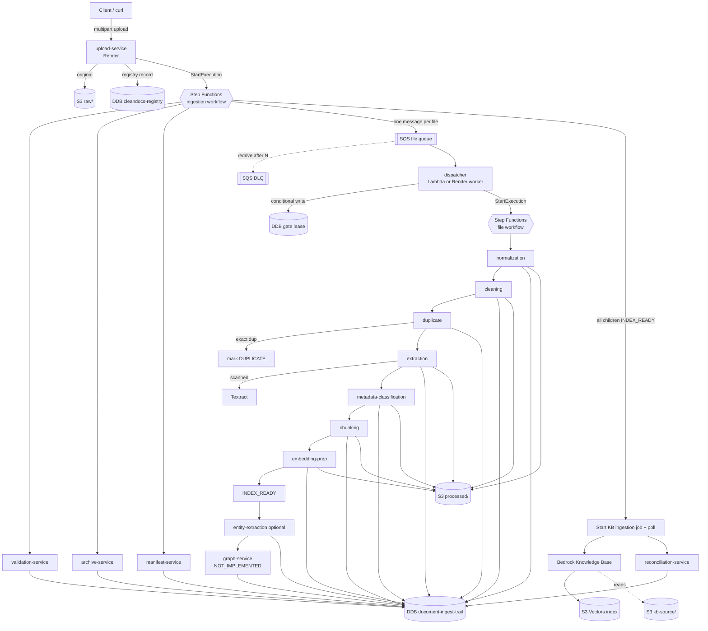

# CleanDocs AI — Phase 0: Architecture and Design

Status: **DRAFT for approval. No implementation code. Phase 1 starts only after you approve.**
Date: 2026-11-20 · Default region: `eu-west-1` · Target: very-low-cost home lab

---

## 0. What I verified before designing (and what I did not)

| Fact | Source / method | Impact |
|---|---|---|
| `eu-west-1` supports S3 Vectors and Titan Text Embeddings V2 (`amazon.titan-embed-text-v2:0`), Cohere Embed v4 and v3 | Live AWS CLI check on your account | Default region is fine. |
| Your account already has an S3 vector bucket `family-docs-vectors` (eu-west-1, created 2026-03-21) | Live AWS CLI check | I will **not** touch it. Decision D6 below. |
| `E:\dev\docindex` is empty | Folder listing | Pure greenfield. |
| Render Free web services spin down after 15 min idle, and take about a minute to wake | Render docs and pricing articles | Drives the whole retry/readiness design. |
| Render background workers have **no Free tier**; cheapest paid instance is $7/month, which is also the always-on web service price | Render pricing summaries (2026) | A Render dispatcher worker is a fixed $7/month. |
| Free web services: 750 instance-hours per workspace per month, ephemeral filesystem, 512 MB RAM | Render docs / pricing summaries | Archive and PDF size limits must be small. |
| S3 Vectors + Bedrock KB: semantic search only (no hybrid), ~1 KB custom metadata and 35 keys per vector, floating-point vectors only | AWS S3 Vectors user guide | Keep chunk metadata tiny. |
| Textract: DetectDocumentText about $1.50 per 1,000 pages; Forms and Tables about $15 per 1,000 pages each | 2026 pricing summaries of the AWS page (an older AWS announcement lists Forms at $0.05/page, so the Forms rate is unconfirmed) | Textract is the main per-document cost driver. |

**Not verified yet (will be spiked in Phase 2 before I rely on them):**
- Exact CloudFormation resource coverage for S3 Vectors and Bedrock KB.
- Step Functions HTTP Task timeout and payload limits.
- Whether Bedrock `IngestKnowledgeBaseDocuments` (direct ingestion) works with an S3 Vectors store.
- Concurrent ingestion-job limits per data source.
- Current Bedrock per-token prices. I give no per-token numbers in this document on purpose.

---

## 1. Where I challenge the brief (please decide)

Each item is a place where following the brief literally adds cost or fragility.

**C1. A Render worker for SQS polling is a fixed $7/month and the only thing that must be always on.**
It exists only to turn "one SQS message" into "one Step Functions execution" plus a gate check. SQS → tiny Lambda (reserved concurrency 1) does the same for effectively $0 at home-lab volume, with no cold-start problem.
**Recommendation: Lambda dispatcher (D1).** I will still write the dispatcher as a plain Python module so it can run as a Render worker unchanged if you prefer.

**C2. 15 always-on Render services would be 15 × $7 = $105/month.** Free instances sleep and wake in about a minute, and a document passes through about 12 services. Naive cost: roughly 12 cold starts per document if services were idle.
**Recommendation:** keep all 15 as independent apps with their own Dockerfile, but deploy them on **Free** by default. Step Functions uses a readiness-retry loop, and a service is promoted to Starter ($7) only if its cold start proves unacceptable (D2). Do **not** use keep-alive pingers: Render has told users that keeping free services artificially awake is abuse of the free tier.

**C3. Indexing per file is wasteful and fragile.** A Bedrock KB ingestion job syncs a data source; running one per file (and per ZIP child) means many jobs, and I believe only one job can run at a time per data source (to verify).
**Recommendation:** the **file** workflow ends at `INDEX_READY` (chunks and metadata written). A single **ingestion-level** step then runs one KB ingestion job for the whole batch and waits for it (D3). A single upload is just a batch of one.

**C4. "Embedding Service" and "Bedrock KB" would double-embed.** Bedrock KB embeds the data source itself.
**Recommendation:** our chunker is the only chunker (KB data source chunking = `NONE`, i.e. each object is one chunk). The "Embedding Service" becomes **embedding-prep**: token-budget check, chunk-hash dedupe, KB-ready object plus metadata sidecar, model config tracking. It makes no vectors itself. Trade-off: no per-chunk embedding audit, only job-level counts (D4).

**C5. Customer-managed KMS keys cost about $1/key/month each.** Use SSE-S3 (or AWS-managed keys) plus a private bucket plus bucket policy. Revisit if you want key-level audit.

**C6. A strict global lock can deadlock.** If a Step Functions execution dies without releasing the gate, nothing runs again. The gate therefore uses a **lease with expiry** plus a reaper that checks `DescribeExecution` (section 6.3).

**C7. SQS receive-count trap.** With a busy gate, every re-receive increments `ApproximateReceiveCount` and could push healthy messages into the DLQ. The dispatcher must check the gate **before** receiving (section 7).

**C8. Bucket naming.** S3 names must be lowercase, so `CleanDocs-raw` is invalid. Proposal: **one bucket**, `cleandocs-<account-id>-eu-west-1`, with prefixes. Two buckets add policy surface and no isolation benefit at this scale.

**C9. Services never call each other.** Step Functions is the only caller of file-level services. This removes service-to-service auth fan-out, avoids chained cold starts, and keeps shared code from becoming hidden coupling.

**C10. IaC choice: AWS SAM (CloudFormation).** No state backend to host or lose, native Step Functions ASL with substitutions, `sam delete` is a clean teardown, and it is friendly on Windows PowerShell. Terraform would need a remote state bucket and lock table. (D5; CloudFormation coverage of S3 Vectors/Bedrock KB to be confirmed in Phase 2, with a small script fallback.)

---

## 2. Architecture diagram



Every box except the S3/DynamoDB/SQS/Bedrock/Textract/Step Functions resources is application code. There is **no** OpenSearch, Neptune, Redis, NAT Gateway, EC2, EKS, load balancer or API Gateway.

---

## 3. Service inventory and responsibility matrix

All services: own FastAPI app, Dockerfile, requirements, tests, `/health/live`, `/health/ready`, `/api/v1/service/info`, `POST /api/v1/process`, `GET /api/v1/executions/{id}`, own audit writes. Heavy dependencies are service-specific.

| # | Service | Invoked by | Reads | Writes | Notes / key libraries (proposed) |
|---|---|---|---|---|---|
| 1 | upload-service | Client | multipart body | `raw/`, registry, starts ingestion SFN | Only public endpoint (API-key protected). Streams to S3, computes SHA-256 while streaming. |
| 2 | validation-service | Ingestion SFN, file SFN | `raw/` object | verdict + audit | `python-magic`/`filetype` signature check, size, ext vs MIME vs magic agreement, `pikepdf`/`zipfile` structural checks. |
| 3 | archive-service | Ingestion SFN | ZIP in `raw/` | child originals in `raw/`, archive manifest | Streaming extraction with ZIP-Slip, bomb, count, depth limits. Nested archives rejected by default. |
| 4 | manifest-service | Ingestion SFN | registry | manifest items, parent/child links, roll-up | Thin on purpose: bookkeeping and reconciliation inputs only. |
| 5 | normalization-service | File SFN | `raw/` | `processed/normalized/` | Format-aware (PDF pages, DOCX blocks, XLSX sheets, CSV, text, JSON/XML) into one internal JSON schema (pages, blocks, tables, reading order). |
| 6 | cleaning-service | File SFN | normalized | `processed/cleaned/` | Whitespace, line endings, safe OCR fixes only. **Numeric/date/currency tokens are frozen**: a post-clean diff check fails the stage if protected tokens changed. |
| 7 | duplicate-service | File SFN | registry | verdict | Exact SHA-256 via conditional put on a checksum-claim item. Policy: `SKIP`, `LINK`, `REPROCESS`. No semantic "duplicates". |
| 8 | extraction-service | File SFN | cleaned/normalized | `processed/extraction/{raw,normalized}/` | Local parsers first: `pypdf`/`pdfplumber` (searchable PDF), `python-docx`, `openpyxl`, csv. Textract only for scanned PDFs/images (page-limited, budget-guarded). |
| 9 | metadata-service | File SFN | extraction | `processed/metadata/` | Deterministic rules first (keywords, regex, dates); Bedrock model only when confidence is below a threshold, with per-doc and monthly token caps. |
| 10 | chunking-service | File SFN | extraction + metadata | `kb-source/{doc}/{chunk}.txt` + `.metadata.json`, chunk manifest | Per-category strategies (clauses, test groups, line items, statement sections). Fixed-size is only a fallback. |
| 11 | embedding-service (embedding-prep) | File SFN | chunks | eligibility report, chunk-hash dedupe | See C4. No vectors created here. |
| 12 | vector-indexing-service | Ingestion SFN | `kb-source/` | KB ingestion job record | Starts job, polls status, verifies stats, handles deletes. |
| 13 | entity-extraction-service | File SFN (optional branch) | extraction | `processed/graph-candidates/` | Deterministic patterns; Bedrock only if needed. Non-blocking. |
| 14 | graph-service | File SFN (optional branch) | candidates | audit `NOT_IMPLEMENTED` | Real schemas/contracts. Endpoints return HTTP 501 with `NOT_IMPLEMENTED`. No database. |
| 15 | reconciliation-service | Both SFNs | S3, registry, trail, KB | final status | Evidence-based (object exists + checksum + trail record), never "HTTP 200 means success". |

Plus `workers/sqs-dispatcher` (section 7).

**Shared code policy:** one `shared/` package (config, logging, audit, auth, errors, models, AWS client factories). It is copied into each image at build time and **versioned**; each service pins a version. Shared code contains no business logic, so a service can be redeployed without redeploying others.

---

## 4. Document lifecycles

### 4.1 A normal searchable PDF
1. **upload-service** streams the file to `raw/documents/{doc_id}/original/{filename}`, computes SHA-256, writes registry `DOC#{doc_id}` (state `UPLOADED`), writes audit, starts the **ingestion workflow** with `{ingestion_id, doc_id}`.
2. **validation**: size, extension, magic bytes, MIME agreement, PDF structure, checksum re-verify. Fail → `REJECTED`.
3. Not a ZIP, so **manifest-service** records a single-file manifest and the workflow sends **one SQS message**.
4. **Dispatcher** sees a free gate, takes the lease, starts the **file workflow** (execution name = `{doc_id}-a{attempt}`, so a duplicate start is idempotent), records the workflow ARN, then deletes the SQS message.
5. File workflow: normalization → cleaning → duplicate check → extraction (local PDF parser; text density test says "searchable", so no Textract) → metadata/classification → chunking → embedding-prep. Each stage: readiness check, call, audit, output checksum. The document reaches `INDEX_READY`.
6. Gate lease released (also on failure via Catch).
7. Ingestion workflow (waiting for all children) runs **one KB ingestion job**, polls until `COMPLETE`, verifies counts against the chunk manifest.
8. **reconciliation** checks the evidence chain and sets `COMPLETED` (graph = `NOT_IMPLEMENTED`).

### 4.2 A ZIP archive
1. Upload as above; validation sees a ZIP signature and routes to **archive-service**.
2. Archive-service streams entries and enforces: no absolute or `..` paths, per-entry and total expanded-size caps, entry-count cap, nesting depth 0 by default, compression-ratio check, supported types only. Each accepted entry becomes a **child document** with its own `doc_id`, a copy under `raw/documents/{child_id}/original/` (never overwriting: conditional put), and registry link `parent_document_id`.
3. Unsupported or unsafe entries are recorded in the manifest as `REJECTED` with a reason; they do not fail siblings.
4. Manifest-service writes `INGEST#{id}` membership items; the workflow publishes **one SQS message per child**.
5. Children run the file workflow **sequentially** (gate). Each has its own audit history.
6. After all children are terminal: one KB ingestion job for everything `INDEX_READY`, then archive-level reconciliation: `COMPLETED` if all accepted children completed, `PARTIAL` if some failed or were rejected, `FAILED` if none succeeded. Exact duplicates are `DUPLICATE` and counted as accounted-for.

---

## 5. S3 design

One private bucket, `cleandocs-<account>-eu-west-1` (SSE-S3, TLS-only policy, Block Public Access, versioning on).

```text
raw/documents/{document_id}/original/{filename}          immutable, never rewritten
processed/documents/{document_id}/
    normalized/  cleaned/  extraction/raw/  extraction/normalized/
    metadata/  manifests/  assets/  graph-candidates/
kb-source/{document_id}/{chunk_id}.txt                   the ONLY copy of chunk text
kb-source/{document_id}/{chunk_id}.txt.metadata.json     sidecar (small, see limits)
tmp/{execution_id}/...                                   scratch
```

- **Immutability without Object Lock:** bucket policy denies `s3:DeleteObject*` and overwrite on `raw/` for application roles (conditional `If-None-Match` writes). Deletion is a deliberate admin workflow.
- **No duplicate chunk copies:** the brief's `chunks/` prefix is replaced by `kb-source/`; `processed/.../manifests/chunks.json` holds only pointers and hashes.
- **Deterministic stage keys + checksums** make every stage idempotent: if the output exists and the recorded `input_checksum` + `service_version` match, the stage is `SKIPPED`.
- **Lifecycle rules:** `tmp/` expires in 1 day; abort incomplete multipart in 7 days; `extraction/raw/` expires in 30 days (configurable); noncurrent versions expire in 30 days. Text and JSON artifacts live in S3; DynamoDB only stores references.
- Pre-signed URLs: only for operator downloads, ≤15 minutes, never stored.

---

## 6. DynamoDB design

Both tables are **on-demand (pay-per-request)**, no GSIs, point-in-time recovery off by default (enable later if wanted; it costs per GB).

### 6.1 Access patterns (decided before the schema)

| # | Pattern | Served by |
|---|---|---|
| A1 | Full audit history of one document in time order | trail: Query `PK=DOCUMENT#id` |
| A2 | All executions of one service for one document | trail: Query same PK + filter on `service_name` |
| A3 | Audit for the ingestion/archive itself | trail: Query `PK=INGESTION#id` |
| A4 | Trace one document across services | A1 (every record carries `trace_id`, `workflow_execution_id`) |
| A5 | Current state of a document | registry: GetItem `DOC#id / META` |
| A6 | Children of an archive / all docs in an ingestion | registry: Query `PK=INGEST#id, SK begins_with DOC#` |
| A7 | Is this checksum already known? | registry: conditional PutItem on `CHECKSUM#sha256 / CLAIM` |
| A8 | May a new file workflow start? | registry: conditional UpdateItem on `GATE#GLOBAL / LOCK` |
| A9 | Documents by status (operator view) | **Scan** at home-lab scale (a sparse GSI is a later option; not worth the cost now) |

### 6.2 `document-ingest-trail` (append-only audit)

- `PK = DOCUMENT#{document_id}` (or `INGESTION#{ingestion_id}`)
- `SK = EXEC#{started_at_iso}#{service_execution_id}#{rank}#{EVENT}` (rank 0 = RETRIED, 1 = STARTED, 2 = terminal, so one execution reads in lifecycle order; found by a Phase 1 test) where `EVENT` is `STARTED`, `COMPLETED`, `FAILED`, `SKIPPED`, `RETRIED`, `NOT_IMPLEMENTED`.
  *Deviation from your example SK:* time-first keeps A1 chronological in one query; service name is still in the key and in an attribute.
- `service_execution_id = {service_name}_{YYYYMMDDTHHMMSSZ}_{6-hex of uuid4}`, e.g. `validation-service_20261120T151515Z_92eab4`.
- **Immutability:** every write is `PutItem` with `attribute_not_exists(PK)`. A service invocation writes a `STARTED` item and later a terminal item (two immutable rows, same `service_execution_id`), never an update. A retry is a new execution ID and a `RETRIED` event referencing the previous ID.
- Attributes: all fields listed in your section 8.2, plus `event`, `error_class`, `retryable`, and `ttl` (optional, off by default).
- IAM: services get `PutItem` and `Query` on this table only, with no `UpdateItem` or `DeleteItem`.

### 6.3 `cleandocs-registry` (mutable state, single-table)

| PK | SK | Purpose |
|---|---|---|
| `DOC#{id}` | `META` | state, current stage, checksum, S3 URIs, parent id, ingestion id, indexing state, final status, graph status, workflow ARN |
| `INGEST#{id}` | `META` | ingestion state, counts, KB ingestion job id and status |
| `INGEST#{id}` | `DOC#{id}` | manifest membership, per-file state (A6) |
| `CHECKSUM#{sha256}` | `CLAIM` | canonical document id, first-seen time (A7); duplicate = condition failure |
| `GATE#GLOBAL` (or `GATE#INGEST#{id}`) | `LOCK` | `holder_document_id`, `workflow_arn`, `lease_expires_at`, `fence` |
| `BUDGET#{yyyy-mm}` | `COUNTERS` | atomic `ADD` counters: Textract pages, Bedrock tokens (cost guard) |

**Gate (A8):** `UpdateItem ... ConditionExpression: attribute_not_exists(holder) OR lease_expires_at < :now`. The file workflow's final states (success and Catch paths) release it with a conditional update matching the holder, using the Step Functions DynamoDB SDK integration (no Lambda). A reaper step in the dispatcher calls `DescribeExecution` on an expired holder and takes over safely. It survives Render restarts and redeploys because no state is in memory. Modes: `GLOBAL`, `PER_INGESTION`, or `CONCURRENT(n)` (future: n lock items).

---

## 7. SQS and dispatcher

- **Standard queue + DLQ.** Ordering is enforced by the gate, not by FIFO (FIFO would not give global single-flight across workflows anyway). DLQ retention 14 days.
- **Message** (small, no document content): `{document_id, ingestion_id, parent_document_id, s3_uri, checksum, attempt, trace_id}`.
- **Dispatcher loop** (Lambda with reserved concurrency 1, or Render worker):
  1. Read the gate. If held and the lease is live, **do not receive**; exit (Lambda is re-triggered by schedule or by the workflow's release step).
  2. Receive 1 message (short visibility timeout, e.g. 60 s, since handoff is quick).
  3. Validate the schema; check registry state (skip if already `PROCESSING`, `COMPLETED`, `DUPLICATE`).
  4. Acquire the gate with a conditional write. If lost, `ChangeMessageVisibility` back and stop.
  5. `StartExecution` with name `{doc_id}-a{attempt}` (idempotent), store the workflow ARN in the registry.
  6. **Delete the SQS message only after step 5 and the registry write succeed.**
- `maxReceiveCount` is 5. Because step 1 avoids receiving while busy, the count reflects real failures only.
- **Poison/permanent failures:** dispatcher failures after 5 receives go to the DLQ. Workflow failures are caught inside Step Functions, recorded in the trail, release the gate, and send a **replay record** (document id, failed stage, artifact refs, workflow id) to the DLQ.
- **Replay:** an operator script re-enqueues from a failed stage. Because stage outputs are checksum-addressed, completed upstream stages are `SKIPPED`, so no repeated OCR or embedding.

---

## 8. Step Functions

Two **Standard** workflows (Express is a poor fit: long waits, cold starts).

**Ingestion workflow:** accept → validate original → `Choice(is_zip)` → [archive-service] → manifest → publish N SQS messages (SDK integration, no Lambda) → wait until all children terminal (poll the registry with a Wait + Choice loop, capped) → `Choice(any INDEX_READY)` → KB ingestion job (start, poll, verify) → reconciliation → terminal.

**File workflow:** `Choice(supported_format)` → normalization → cleaning → duplicate (`Choice(exact_duplicate)` → mark `DUPLICATE`, release gate) → extraction (`Choice(searchable_pdf)` → local parser, else Textract branch, budget-checked) → metadata → chunking → embedding-prep → mark `INDEX_READY` → optional entity-extraction → optional graph (explicit `NOT_IMPLEMENTED` record) → release gate. A top-level `Catch` on every task writes the failure, releases the gate and emits the replay record.

**Calling a Render service** (every task, same pattern): `GET /health/ready` with Retry (retry on timeouts and 5xx; interval 15 s, backoff 1.5, max about 8 attempts, which covers a ~1 min cold start with margin) → `POST /api/v1/process` with `Idempotency-Key` and `X-Trace-Id`. Transient (5xx, timeout, 429, Bedrock throttling) → retry with backoff and jitter; permanent (4xx validation, unsupported, business rules) → no retry, fail fast. Exact retry/timeout numbers are tuned in Phase 7. For long stages (extraction, Textract) the plan is **202 Accepted + callback** with `waitForTaskToken`, so Step Functions is not held by an HTTP timeout. I will confirm the HTTP Task limits in the Phase 2 spike.

**What can and cannot be verified:** from AWS you can only observe HTTP behaviour (connect, status codes, latency). A 200 on `/health/ready` proves the process is up and its dependencies respond **at that moment**; it does not tell you the Render lifecycle state, whether the instance is about to be recycled, or whether a deploy is in flight. The durable proof of work is the S3 artifact + checksum + trail record, which is why reconciliation uses those and never HTTP status.

**Service-to-service auth:** Step Functions HTTP Task uses an EventBridge connection holding a per-service API key sent as `Authorization: Bearer`; services compare in constant time and also accept only the Step Functions-supplied `X-Trace-Id`. Keys live in Render environment variables and the connection (never in git); rotation is manual and documented. Stronger options (signed JWT, mTLS) are not available to the HTTP Task without a Lambda, and I consider them over-engineered for a home lab. Only `upload-service` is meant to be reached by a human client.

---

## 9. Bedrock Knowledge Bases + S3 Vectors

**One coherent design:**

| Responsibility | Owner |
|---|---|
| Structure-aware chunking | **Our chunking-service** (KB data source chunking strategy = `NONE`; one object = one chunk) |
| Chunk metadata (document id, chunk id, category, date, page) | Our sidecar `.metadata.json` (kept well under the ~1 KB / 35-key limit; no long text, no PII beyond ids) |
| Embedding generation | **Bedrock KB** (model configurable; default proposal `amazon.titan-embed-text-v2:0`, confirmed available in eu-west-1) |
| Vector storage | **S3 Vectors** index (new `cleandocs` vector bucket; not the existing `family-docs-vectors`, unless you choose otherwise, D6) |
| Eligibility, token limit check, dedupe by chunk hash, model/version tracking | Our embedding-prep |
| Ingestion job start, polling, stats verification | Our vector-indexing-service |
| Deletion | Delete `kb-source/{doc}/` objects, run ingestion job, verify |

**Limitations I accept (and you should know):**
1. Embedding is not visible per chunk; we only see job-level counts (scanned/indexed/failed).
2. S3 Vectors gives semantic search only (no hybrid), which matters for the future retrieval phase, not this one.
3. Changing the embedding model later means a full re-index (new index, since dimensions are fixed per index).
4. Ingestion jobs are minutes-scale, so document completion is delayed until the batch finishes.
5. KB creation with a Titan model needs model access enabled in the account.

---

## 10. Knowledge graph skeleton

Deliver in Phase 6: Pydantic schemas (`Entity`, `Relationship`, `EvidenceRef`), JSON Schemas stored in `docs/`, and graph-service contract endpoints: `POST /api/v1/graph/resolve-entities`, `/extract-relationships`, `/persist`, `/validate`. Each returns **HTTP 501** with `{"status":"NOT_IMPLEMENTED"}` and writes a `NOT_IMPLEMENTED` audit event. Entity candidates (from entity-extraction) are written to `processed/.../graph-candidates/` with page and evidence. Graph status lives in a separate registry field (`graph_status`), never blocks `COMPLETED`, and is never reported as completed. No Neptune, no DynamoDB-as-graph.

---

## 11. Render deployment architecture

| Option | Monthly Render cost | Behaviour | When to use |
|---|---|---|---|
| **A. All 15 on Free, Lambda dispatcher (recommended start)** | $0 | Cold start about a minute per service; readiness retry absorbs it; 750 instance-hours shared | Home lab, patient pipeline |
| B. A + hot services on Starter | $7 per service | No sleep for those services | Promote extraction/metadata/chunking only if cold starts hurt |
| C. Render worker as dispatcher | +$7 | Always-on, no Lambda | If you prefer one platform |
| D. All 15 on Starter | about $105 | No sleeping | Not justified for a home lab |

Notes: Free instances have an ephemeral filesystem and 512 MB RAM, so streaming I/O and small limits (default 25 MB per file, 100 MB expanded archive, 50 files) are mandatory. A restart can never lose messages because the durable state is SQS + DynamoDB + S3, not the instance. Each service has its own `render.yaml` entry (Docker, health check path `/health/ready`, env vars by reference), and its own version tag.

**AWS credentials on Render:** Render cannot assume an IAM role natively, so each service group gets an IAM user with a least-privilege policy and long-lived keys stored only as Render secrets (3 tiers: ingest, processing, indexing). That is the main security compromise of the Render choice; Lambda container images would avoid it (explained here for transparency, not proposed since Render is your requirement).

---

## 12. Security design

Private bucket, SSE-S3, TLS only; least-privilege per tier; no credentials in git (`.env.example` placeholders only); API keys per service; request size limits; magic-byte validation; archive hardening; logs contain ids, sizes, hashes and durations, **never document text or extracted values**; error responses never echo content; pre-signed URLs ≤15 min; DynamoDB trail table is append-only by IAM. You currently use an IAM user with full access for the AWS tooling; for Phase 2 I will create a scoped deploy role and recommend not using the full-access user for runtime. Local dev uses a named AWS profile; Render uses secrets.

---

## 13. Cost estimate

All usage-priced AWS pieces are pay-per-use. **Exact per-token Bedrock and per-request prices are not stated here** because I have not verified them; Phase 2 will pull current numbers from the AWS pricing pages.

| Component | Why | Charged on | Idle cost | Can be disabled |
|---|---|---|---|---|
| S3 (raw/processed/kb-source) | storage | GB-month + requests | cents | delete objects/bucket |
| S3 Vectors | vector store | stored vectors, writes, queries | near zero at home-lab scale | delete index |
| Bedrock KB | managed ingestion | embedding model tokens at ingestion | none | delete KB |
| Bedrock model (classification/entities) | only low-confidence docs | tokens | none | `AI_ENRICHMENT=off` |
| Textract | scanned PDFs/images | per page (about $0.0015 text; about $0.015 tables; about $0.015 forms) | none | `OCR=off` |
| SQS | handoff | requests (large free tier) | $0 | n/a |
| Step Functions Standard | orchestration | state transitions (about 50-70/doc; free tier covers a few thousand/month; verify) | $0 | n/a |
| DynamoDB on-demand | registry + audit | read/write units | $0 idle | delete tables |
| Lambda (dispatcher) | trigger | invocations | $0 at this scale | n/a |
| CloudWatch Logs | essential logs | ingest + storage | small; set 7-14 day retention | reduce |
| Render | services | per instance | $0 Free / $7 Starter | suspend |

**Fixed or idle charges to watch:** any Render paid instance ($7 each), CloudWatch log storage, S3 and S3 Vectors storage, and customer-managed KMS keys if you add them (avoided by default).

| Scenario | Assumptions | Cost shape |
|---|---|---|
| 1. Minimal dev | 10-20 small docs/month, mostly digital, Render Free, Lambda dispatcher | essentially pennies plus any Textract pages; Render $0 |
| 2. Normal home lab | 100-300 docs/month, about 10% scanned (about 100 Textract text pages = about $0.15; with tables about $1.50 extra) | single-digit dollars, dominated by Textract and Bedrock tokens; Render $0 to $14 |
| 3. Higher-volume test | 1,000+ docs, many scanned | Textract and embeddings dominate; guarded by monthly page/token caps; Render free-hour limit (750) may force Starter on 1-2 services |

**Guardrails built in:** monthly counters in `BUDGET#yyyy-mm` stop OCR and Bedrock calls at a configurable cap (document goes `REJECTED`/deferred with reason, not silently skipped); AWS Budgets alert recommended (the first budgets are free; verify).

---

## 14. Project structure

Your suggested structure is good. Changes I propose: (1) `kb-source/` is in the bucket layout, not a service; (2) `infrastructure/` uses SAM (`template.yaml` plus nested stacks per concern, `cleanup` scripts); (3) `shared/` is built as one versioned package and copied into each image; (4) add `scripts/replay.ps1`, `scripts/trace.ps1` (trace one document), `scripts/cleanup.ps1`; (5) `workers/sqs-dispatcher` doubles as Lambda handler and Render worker entrypoint.

## 15. Technology decisions

Python 3.12, FastAPI, Pydantic v2, Uvicorn, Boto3, pytest, `moto` for AWS mocks (no AWS cost in unit tests), `python-magic`/`filetype`, `pypdf` + `pdfplumber`, `python-docx`, `openpyxl`, `Pillow` (images). All pinned per service; heavy libraries only in services that need them. Structured JSON logging via the standard library plus a small formatter.

## 16. Major risks and trade-offs

| Risk | Mitigation |
|---|---|
| Cold starts (about 1 min) multiply across about 12 stages | Readiness retry; promote hot services; keep stages coarse |
| Free-tier 750 hours and 512 MB RAM | Small limits; streaming; Starter for the heaviest service |
| Gate deadlock or stuck lease | Lease expiry, reaper via `DescribeExecution`, fencing token |
| KB ingestion-job semantics (concurrency, latency) | Phase 2 spike; batch per ingestion |
| Long-lived AWS keys on Render | Three least-privilege users, rotation runbook |
| Bedrock/Textract cost drift | Monthly caps, deterministic-first extraction, exact-duplicate skip |
| Sensitive documents | No content in logs, private bucket, short URLs, append-only trail |
| CloudFormation coverage gaps for S3 Vectors/KB | SAM for the core, small CLI script for gaps |

---

## 17. Decisions I need from you (then I start Phase 1)

| ID | Decision | My recommendation |
|---|---|---|
| D1 | Dispatcher: Lambda vs Render worker ($7/mo) | Lambda |
| D2 | Render: all Free at first vs some Starter | All Free, promote on evidence |
| D3 | KB indexing: one job per ingestion batch vs per file | Per batch |
| D4 | Embedding service = prep only (KB embeds) | Yes |
| D5 | IaC: SAM / CDK / Terraform | SAM |
| D6 | Reuse existing `family-docs-vectors` or create a fresh vector bucket | Fresh, leave the old one untouched |
| D7 | Entity-extraction failure: ignore (still `COMPLETED`) or `PARTIAL` | Ignore (optional stage) |

Reply "approved" (or list changes by ID) and I will begin **Phase 1 — Project Foundation**.
